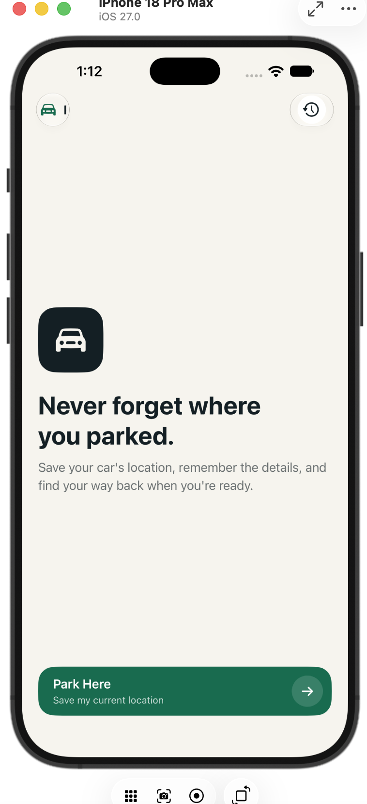
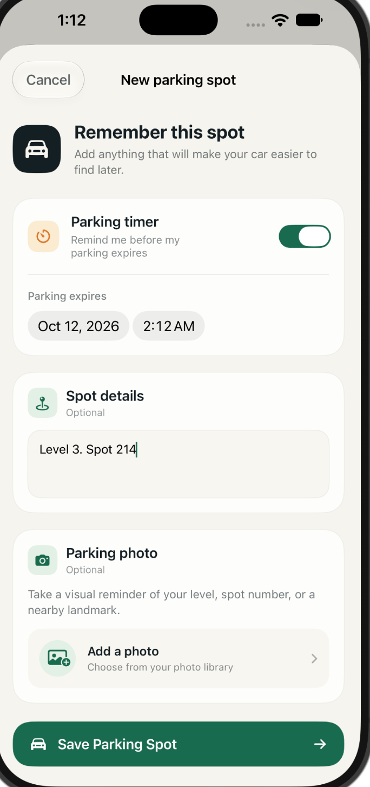
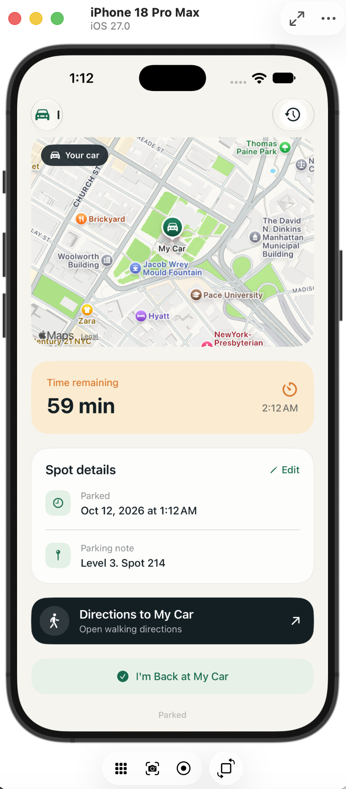
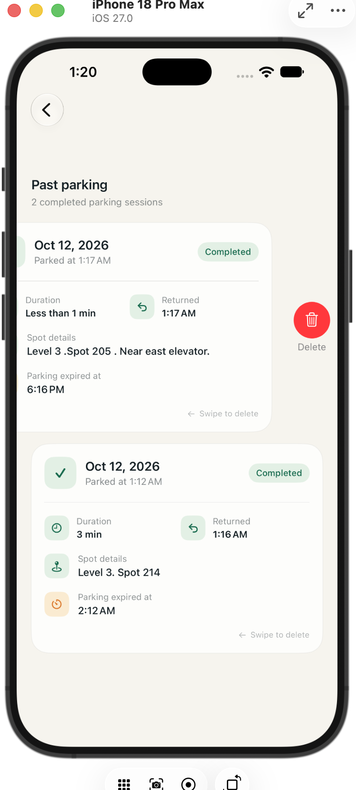

# Parked 🚗

Parked is a native iOS app I built to solve a simple problem: forgetting where you parked.

The app saves your car's location, keeps track of parking details and meter expiration, and gives you walking directions back when you're ready to leave. I wanted the project to feel like something I could actually use, while also giving me a chance to work with native iOS features like location services, maps, notifications, local persistence, and photos.

## Screenshots

| Home | Save Parking |
| --- | --- |
|  |  |

| Active Parking | Parking History |
| --- | --- |
|  |  |

## What it does

When you park, Parked can save your current location along with a few details that might help you find the car later.

You can:

- Save your parked-car location
- Add a level, row, spot number, or other note
- Attach a parking photo
- Set a parking expiration time
- Get a reminder 10 minutes before parking expires
- See your car's location on a map
- Open walking directions back to your car
- Mark a parking session as complete
- View previous parking sessions in your history

Parking sessions are stored locally, so your active spot and parking history are still there after closing and reopening the app.

## Built with

- Swift
- SwiftUI
- MapKit
- Core Location
- SwiftData
- UserNotifications
- PhotosUI

## How it works

The main data model is a `ParkingSpot`, which stores the coordinates of the car along with the parking time, optional expiration time, note, photo, and whether the session is still active.

SwiftData handles persistence, while Core Location provides the car's coordinates. The saved coordinates are displayed with MapKit and can also be passed to Apple Maps to start walking directions back to the vehicle.

If the user adds an expiration time, the app keeps track of the remaining time and schedules a local notification for 10 minutes before parking expires.

Once the user returns to the car, the session is marked as complete instead of being deleted. That lets it appear in Parking History with information like the parking time, return time, duration, note, and expiration time.

## A few things I learned

This was my first project focused specifically on building a complete native iOS experience.

One of the more interesting parts was connecting several Apple frameworks together rather than treating each feature separately. Saving a parking spot involves getting a location, persisting it, displaying it on a map, optionally scheduling a notification, and then keeping that data consistent as the session moves from active parking into history.

I also spent time refining the UI instead of leaving the app with mostly default SwiftUI styling. I wanted Parked to have its own visual identity while still feeling natural on iOS.

## Running locally

You'll need Xcode and either an iOS Simulator or a physical iPhone.

Clone the repository:

```bash
git clone https://github.com/SorayaM0/parked-ios.git
```

Open the project in Xcode, select a simulator or connected device, and run it with `⌘R`.

The first time you use the app, iOS will ask for location and notification permissions.

> **Simulator note:** Core Location can sometimes fail to return a simulated location. For debug builds running in the iOS Simulator, the project includes a test-location fallback so the parking flow can still be tested. Physical devices use Core Location normally.

## What's next

There are a few directions I could take Parked in the future, such as improving location error handling, adding richer parking-session editing, and testing more of the experience on physical devices.

For now, the goal was to build a focused iOS app around one everyday problem and take the full workflow from an idea to a working product.

---

Built by **Soraya Mosavi**, Computer Science student at Rutgers University.
